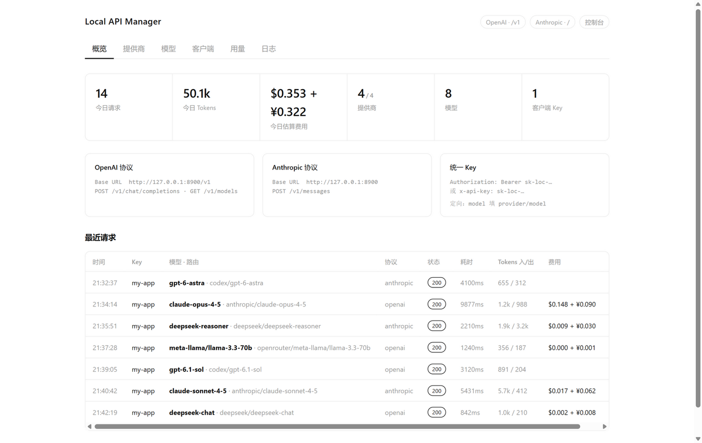
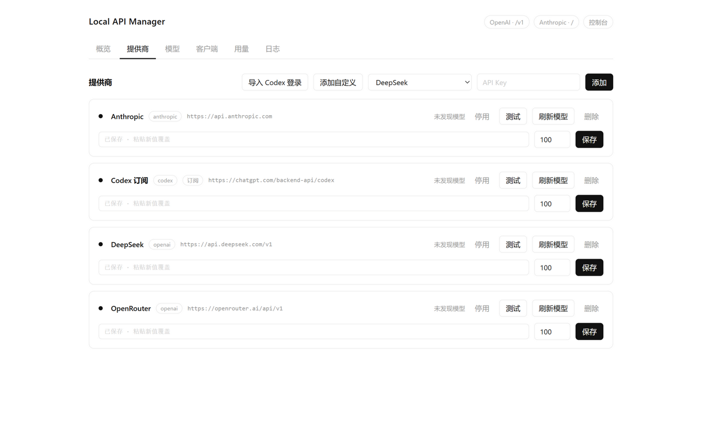

<div align="center">

# Local API Manager

**把所有大模型 API 聚合到本地一个端口、一把 Key**

One local port. One key. Every LLM provider.

OpenAI 与 Anthropic 双协议进出 · 任意客户端 × 任意上游 · 纯白本地控制台


[快速开始](#快速开始) · [特性](#特性) · [架构](#架构) · [接入提供商](#接入提供商) · [模型路由](#模型路由) · [控制台](#控制台) · [Codex 订阅](#codex-订阅) · [后台常驻](#后台常驻) · [开发](#开发)

</div>

---

## 快速开始

```bash
git clone https://github.com/wqx-txdsyl/Local-API-Manager.git
cd Local-API-Manager
pip install -r requirements.txt
python main.py
```

打开控制台 **http://127.0.0.1:8800/console**，添加一个提供商，生成一把 `sk-loc-*` Key，
然后让所有客户端指向：

| 客户端类型 | Base URL | API Key |
| --- | --- | --- |
| OpenAI 兼容（SDK / Codex CLI / openai 客户端…） | `http://127.0.0.1:8800/v1` | `sk-loc-…` |
| Anthropic 兼容（Claude Code / anthropic 客户端…） | `http://127.0.0.1:8800` | `sk-loc-…` |

模型名直接写上游名：`deepseek-chat`、`claude-sonnet-4-5`、`gpt-6.1-sol`…
或者用 `provider/model` 定向到指定提供商：`deepseek/deepseek-chat`。

## 特性

- **双协议网关** — OpenAI `/v1/chat/completions` 与 Anthropic `/v1/messages` 同端口。
  Claude Code 可以打 DeepSeek，Codex CLI 可以打 Claude，任意组合；
  流式 / 非流式、工具调用、思考块、图片在两种协议间自动互转。
- **一把 Key 管所有客户端** — `sk-loc-*` 统一 Key，可轮换（旧 Key 立即失效）、停用、
  按 Key 独立计量请求 / Tokens / 费用。
- **预配置目录** — DeepSeek · OpenAI · Anthropic · Gemini · xAI · Kimi · 智谱 GLM ·
  通义千问 · 豆包 · 腾讯混元 · MiniMax · SiliconFlow · 阶跃星辰 · OpenRouter · OpenCode Zen。
  下拉选择、粘贴 Key，模型池自动发现。
- **自定义提供商** — 任何 OpenAI / Anthropic 兼容服务（中转站、本地网关、小厂 API），
  弹窗填 名称 / ID / Base URL / 协议 / Key 即接入。
- **Codex 订阅接入** — 读取 `~/.codex/auth.json`（ChatGPT 订阅），refresh token 自动续期，
  模型池来自官方接口（gpt-6.1-sol 等），周配额用量自动捕获显示；
  后端只收流式时自动为非流式客户端做流式聚合。
- **智能路由** — 同名模型多提供商按优先级选取；`provider/model` 直达；
  模型可自定义别名。
- **用量与费用** — 按日 / 提供商 / 客户端 / 模型聚合，请求级日志（协议、路由、耗时、
  Tokens、费用、错误）；订阅型计 0 费用，API 型按刊例价估算，币种随提供商。
- **余额查询** — DeepSeek、SiliconFlow、OpenRouter 支持真实余额接口。
- **本地优先** — 只监听 127.0.0.1，无登录、无云端、无依赖前端构建；
  所有数据在本机 SQLite。

## 架构

```
 Claude Code        Codex CLI        任意 SDK / 脚本
 (Anthropic 协议)   (OpenAI 协议)     (任意协议)
      │                  │                 │
      │  Authorization: Bearer sk-loc-…    │
      └────────┬─────────┴─────────────────┘
               ▼
   ┌──────────────────────────────┐
   │    Local API Manager :8800   │
   │  /v1   /v1/messages  /console│
   │                              │
   │  认证 → 路由 → 协议转换 → 转发 │
   │       → 流式转码 → 记账       │
   └──────────────────────────────┘
     │          │          │         │
     ▼          ▼          ▼         ▼
  DeepSeek   Anthropic   Codex     任何第三方
  (OpenAI)   (Anthropic) (订阅)    (自填 URL + Key)
```

协议转换层：请求体、非流式响应、SSE 流三种粒度上 OpenAI ⇄ Anthropic ⇄ Responses 双向互译，
内部以统一事件流（text / reasoning / tool_start / tool_args / finish）为中枢。

## 接入提供商

控制台「提供商」页三种方式：

1. **预配置** — 下拉选择（17 家），粘贴 API Key，点「添加」；模型池后台自动发现
2. **Codex 订阅** — 点「导入 Codex 登录」，自动读取本机 Codex CLI 登录态
3. **添加自定义** — 弹窗填 名称 / ID / Base URL / 协议 / Key，任何兼容服务都能接

每张提供商卡片支持：启停、优先级（数字小者先）、换 Key、连通测试、刷新模型池、余额、删除。

## 模型路由

请求里的 `model` 字段按以下顺序解析：

1. `provider/model` 形式 → 定向该提供商，绕过路由表
2. 路由表精确匹配（预配置发现的模型 + 手工别名）
3. 各启用提供商的模型池，按优先级取第一个命中

「模型」页可启停单个路由、添加别名（本地名 → 提供商 / 上游名）。

## 控制台

| 页面 | 内容 |
| --- | --- |
| 概览 | 今日请求 / Tokens / 估算费用、双协议端点、统一 Key 用法、最近请求 |
| 提供商 | 三种接入方式 + 提供商管理卡片 |
| 模型 | 全量模型路由表，启停 / 别名 / 删除 |
| 客户端 | 生成 / 复制 / 轮换 / 重置 / 停用统一 Key，按 Key 计量 |
| 用量 | 按日（条形图）/ 按提供商 / 按客户端 / 按模型，近 14 天 |
| 日志 | 请求级明细：协议、路由、状态、耗时、Tokens、费用、错误 |

<div align="center">
  
  
</div>

## Codex 订阅

「导入 Codex 登录」读取 `~/.codex/auth.json`（需先用 Codex CLI 登录过）：

- 模型池从 ChatGPT 后端真实接口拉取（`/models?client_version=…`，自动探测本机 CLI 版本）
- access_token 过期自动用 refresh_token 续期
- 订阅周配额（5h / 周窗口用量百分比、重置时间）从响应头自动捕获，显示在卡片上
- ChatGPT 后端仅接受流式请求，网关对非流式客户端自动做流式聚合

## 后台常驻（Windows）

```powershell
powershell -ExecutionPolicy Bypass -File scripts\install-daemon.ps1     # 安装：登录自启 + 崩溃自动拉起
# 改代码后：双击 restart.bat，数秒内用新代码重启
powershell -ExecutionPolicy Bypass -File scripts\uninstall-daemon.ps1   # 卸载
```

看护进程 `scripts/daemon.py` 由计划任务（当前用户登录触发，pythonw 无窗口）拉起，
循环监控服务进程，退出 3 秒内重启；手动 `run.bat` 运行时只观望、不重复启动。
macOS / Linux 用 launchd / systemd 包一层即可，核心不依赖平台。

日志：`data/daemon.log`（看护）、`data/server.log`（服务）。

## 数据与安全

- 所有数据（提供商 Key、本地 Key、日志、用量）在本机 `data/` 下的 SQLite，不上传任何服务
- 服务仅监听 `127.0.0.1`；控制台 API 拒绝非本机 Host，写操作校验同源 Origin
- 控制台无需登录 ≠ 模型接口无鉴权：所有 `/v1/*` 请求必须带有效 `sk-loc-*` Key
- 备份 / 迁移：复制 `data/` 目录即可；请妥善保管其中的 Key

## 费用口径

按 `app/pricing.py` 的公开刊例价估算，仅用于看板，不代表真实账单；
上游返回真实 usage 时以真实值为准，流式未回报时按输出长度粗估。
订阅型提供商（Codex 等）计 0 费用。

## 开发

```bash
python -B tests/test_offline.py
```

38 项离线端到端测试（mock 上游，零网络依赖）覆盖：
双客户端协议 × 三类上游 × 流式 / 非流式全矩阵、工具调用往返、思考块、
鉴权、路由定向、双协议错误形状、用量记账、Key 生命周期、余额捕获。

```
main.py            FastAPI 路由（/v1/*、/console、/api/*）
app/db.py          SQLite 存储
app/keys.py        统一本地 Key
app/presets.py     预配置目录
app/router.py      模型路由
app/pricing.py     刊例价估算
app/balance.py     余额 / Codex 配额与续期
app/proxy.py       请求管线
app/convert/       协议转换（请求 / 响应 / 流式）
static/            纯白控制台（单文件，无构建）
scripts/           Windows 看护进程与安装脚本
tests/             离线端到端测试
```

## License

[MIT](LICENSE)
